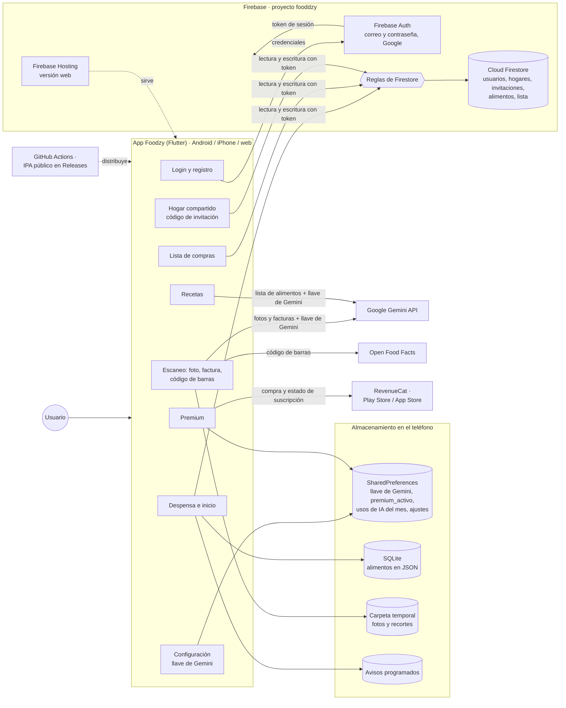

# Fase 1 · Modelo de amenazas de Foodzy

Foodzy es una app Flutter (Android, iPhone y web) para llevar la despensa de la
casa: registra lo que se compra (foto, factura o código de barras), avisa antes
de que algo se venza, propone recetas con lo que hay y permite compartir la
despensa y la lista de compras con las personas del mismo hogar.

Regla base: el teléfono y la app instalada no son de confianza. Lo que importa
(quién ve qué hogar, quién es Premium, cuánto se gasta en IA) debe decidirse en
un servidor.

## 1. Diagrama de la app

Todo el tráfico de red va por HTTPS: los SDK de Firebase,
`generativelanguage.googleapis.com`, `world.openfoodfacts.org`, RevenueCat y las
imágenes de ejemplo.

## 2. Datos sensibles

| Dato | Dónde se guarda (en reposo) | Por dónde viaja (en tránsito) | Sensibilidad |
|---|---|---|---|
| Correo y contraseña | La contraseña no se guarda; el correo queda en Firestore (`usuarios/{uid}`) | App → Firebase Auth | Alta |
| Token de sesión de Firebase | Lo maneja el SDK de Firebase Auth en el teléfono | App → Firestore en cada petición | Alta |
| Cuenta de Google (inicio con Google) | SDK de Google Sign-In | App → Google → Firebase Auth | Alta |
| Llave de API de Gemini | Compilada en el binario (`--dart-define`) o pegada por el usuario y guardada en **SharedPreferences sin cifrar** | App → Gemini (cabecera `x-goog-api-key`) | Alta: quien la tenga gasta la cuota y el dinero del dueño |
| Estado Premium y usos de IA del mes | **SharedPreferences** (`premium_activo`, `ia_usos_AAAA-MM`) | Solo local, salvo la consulta a RevenueCat | Media: de esto depende el cobro |
| Fotos de facturas y de comida | Carpeta temporal del teléfono | App → Gemini | Media: una factura puede traer nombre, cédula, dirección o datos de pago |
| Despensa y lista de compras | SQLite local y Firestore (`hogares/{id}/alimentos`, `/lista`) | App ↔ Firestore | Baja o media: revela hábitos del hogar |
| Hogar: miembros y código de invitación | Firestore (`hogares`, `invitaciones`) | App ↔ Firestore | Media: con el código vigente se entra al hogar |
| Llaves de cliente de Firebase (`AIza…`) | En el código y en `google-services.json` | — | Baja: son públicas por diseño, pero conviene restringirlas en Google Cloud |
| Llaves de RevenueCat (`goog_`, `appl_`) | Se compilan en el binario | App → RevenueCat | Baja: son públicas por diseño |

## 3. Quién podría atacar

| Actor | Qué quiere | Qué tiene a mano |
|---|---|---|
| Cualquiera que descargue la app | Sacar llaves del binario y usarlas gratis | El APK o el IPA (el IPA está público en GitHub Releases), `strings`, jadx, MobSF |
| Usuario que no quiere pagar | Premium o IA sin límite gratis | Su propio teléfono con root o jailbreak; copias de seguridad editables |
| Persona ajena a un hogar o exmiembro | Ver o borrar la despensa de otra familia | Una cuenta propia de Foodzy y el SDK de Firestore |
| Alguien con el teléfono en la mano o con acceso a una copia de seguridad | Datos personales y la llave de Gemini | Backup de Android (`adb backup` o copia en la nube), carpeta temporal y logs |
| Bot o script automatizado | Abusar del proyecto de Firebase (cuentas basura, lecturas masivas) | La configuración pública de Firebase |

## 4. Superficie de ataque

- **Binario (APK, IPA y `main.dart.js` de la web):** todo `String.fromEnvironment` queda escrito dentro.
- **Almacenamiento local:** SharedPreferences, SQLite y la carpeta temporal de fotos.
- **Red:** Firebase, Gemini, Open Food Facts y RevenueCat.
- **Backend:** reglas de Firestore (no hay Cloud Functions; el servidor es solo Firestore).
- **Componentes de Android:** `MainActivity` exportada (es el launcher) y los receptores de notificaciones (`exported="false"`).
- **Deep links:** solo el esquema de Google Sign-In en iPhone; la app no define enlaces propios.
- **WebViews:** no hay.
- **Distribución:** el IPA público en GitHub y la versión web en Firebase Hosting.

## 5. Amenazas principales

### A1 · Robo de la llave de Gemini (OWASP M1, M9)
- **Cómo:** la llave se compila con `--dart-define=GEMINI_API_KEY=…`, así que queda en texto plano dentro de `libapp.so` o del IPA. La llave que pega el usuario se guarda en SharedPreferences sin cifrar, y Android incluye ese archivo en las copias de seguridad.
- **Quién:** cualquiera que tenga el APK o el IPA, o acceso al teléfono o a su backup.
- **Impacto:** usa la cuota de Gemini a costa del dueño de la llave y le deja la factura.
- **Hoy:** la llave nunca se subió al repositorio (`claves.json` está en `.gitignore`; se comprobó en las 91 versiones del historial) y el IPA de GitHub no la incluye. El riesgo está en el binario y en el almacenamiento local.

### A2 · Premium y cupo de IA gratis sin pagar (OWASP M3, M8)
- **Cómo:** `premium_activo` y el contador de usos de IA viven solo en SharedPreferences. Con root, o editando un backup, se pone `premium_activo=true` o se reinicia el contador. Además, el IPA público se compila con `COMPRAS_PRUEBA=true`, que activa Premium sin cobrar.
- **Quién:** usuario que no quiere pagar.
- **Impacto:** se pierden ingresos y el gasto de IA no tiene límite.
- **Hoy:** al abrir la app se consulta RevenueCat, pero si no responde (`null`) se respeta el valor local. Ningún servidor valida el cupo de IA.

### A3 · Entrar a la despensa de un hogar ajeno (OWASP M3)
- **Cómo:** un atacante con cuenta propia intenta leer o escribir `hogares/{id}` llamando directamente al SDK de Firestore, adivinando códigos de invitación o reutilizando el código viejo de un hogar del que lo sacaron.
- **Quién:** una persona ajena al hogar o un exmiembro.
- **Impacto:** ve los hábitos de otra familia y puede borrar o llenar de basura su despensa.
- **Hoy, bien mitigada (defensa en profundidad):** las reglas exigen ser miembro para leer y escribir, solo dejan entrar con el código vigente, no permiten listar invitaciones, generan los códigos con `Random.secure()`, solo el dueño cambia el código o saca a alguien, y limitan el tamaño de los datos. Hay pruebas automáticas de las reglas en `firestore-tests/`.

### A4 · Fuga de datos desde el teléfono (OWASP M9, M6)
- **Cómo:** el `AndroidManifest.xml` no fija `android:allowBackup`, así que la copia de seguridad incluye SharedPreferences (llave de Gemini y estado Premium) y la base SQLite. Además, las fotos de facturas quedan en la carpeta temporal y `debugPrint` escribe los errores completos de la IA y de la búsqueda de productos.
- **Quién:** alguien con acceso físico al teléfono o a su copia de seguridad.
- **Impacto:** se exponen la llave, los datos de las facturas y los hábitos.

### A5 · Datos personales de las facturas enviados a terceros (OWASP M6)
- **Cómo:** la foto completa de la factura se manda a Gemini, y puede traer nombre, número de documento, dirección o los últimos dígitos de la tarjeta.
- **Quién:** el proveedor externo, o cualquiera que robe la llave de A1 y vea el uso del proyecto.
- **Impacto:** se comparten más datos personales de los necesarios.

## 6. Pistas para la Fase 2 (auditoría)

Ya salieron al construir este modelo y se confirmarán con evidencia en la Fase 2:

| Pista | Riesgo OWASP | Dónde |
|---|---|---|
| Llave de Gemini compilada en el binario | M1 | `lib/core/env.dart` |
| Llave de Gemini en SharedPreferences sin cifrar | M9 | `lib/features/configuracion/presentation/providers/api_key_provider.dart` |
| Premium y cupo de IA validados solo en el teléfono | M3 | `lib/features/premium/premium_provider.dart` |
| IPA público compilado con `COMPRAS_PRUEBA=true` | M8 | `.github/workflows/iphone.yml` |
| Release firmado con la llave de debug | M8, M7 | `android/app/build.gradle.kts` |
| `applicationId` de ejemplo (`com.example.foodzy`) | M8 | `android/app/build.gradle.kts` |
| `allowBackup` sin desactivar | M9 | `android/app/src/main/AndroidManifest.xml` |
| `debugPrint` con errores completos | M9 | `gemini_client.dart`, `pantalla_codigo_barras.dart` |
| R8 u ofuscación sin configurar de forma explícita | M7 | `android/app/build.gradle.kts` |
| Comprobar las restricciones de las llaves de Firebase en Google Cloud y App Check | M8 | Consola de Google Cloud y Firebase |
